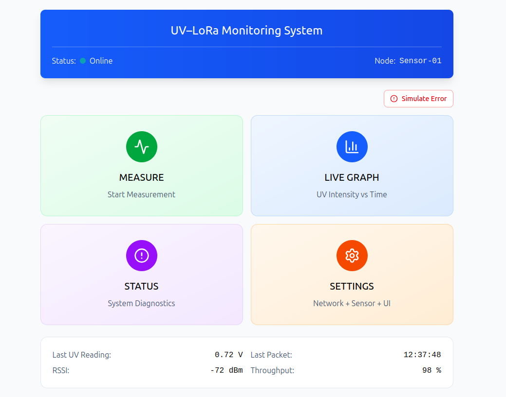
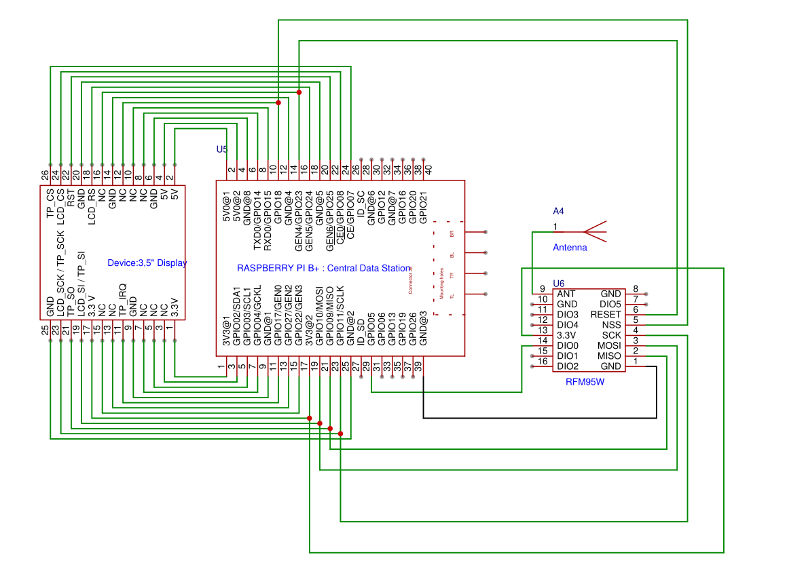
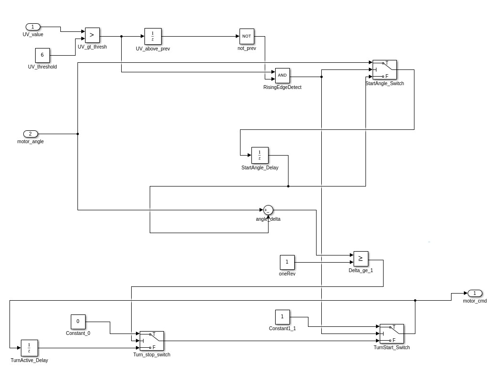

How can a sensor system measure UV radiation, communicate wirelessly, and control a roller blind without depending entirely on the cloud?

As part of an edge-device architecture project, we worked on a decentralised UV-monitoring system using two Raspberry Pi-based nodes:
• Sensor Station
• Central Data System
The Sensor Station measures UV radiation and performs local processing.
The Central Data System receives the measurement through LoRa, displays the system state, and controls a roller-blind actuator according to a configurable UV threshold.

The main hardware components were:
• GUVA-S12SD UV sensor
• ADS1115 16-bit ADC
• Raspberry Pi
• RFM95W LoRa transceiver
• Servo-based blind actuator
• LED status indicator
• Tkinter monitoring interface

The system architecture was:
UV sensor
→ ADS1115 ADC
→ local filtering and validation
→ LoRa packet
→ Central Data System
→ threshold decision
→ roller-blind actuator

The design goal was to keep important processing close to the sensor:
• Convert the analog sensor signal locally.
• Filter and validate the UV value at the edge.
• Transmit compact telemetry packets.
• Make the blind-control decision locally.
• Continue operating without requiring constant cloud connectivity.

The project combined embedded sensing, edge computing, wireless communication, software architecture, and actuator control.

It was a valuable exercise in designing an end-to-end cyber-physical system rather than treating the sensor, communication link, and actuator as isolated components.

  

  

  

The interesting part of an edge device is not only reading a sensor.
The system must transform a physical signal into a reliable decision and then into an actuator command.

For the UV-monitoring project, the processing flow was:
1. The GUVA-S12SD produces an analog voltage.
2. The ADS1115 converts the signal into a digital measurement.
3. The Raspberry Pi applies offset correction.
4. A low-pass filter reduces short-term fluctuations.
5. The voltage is converted into a UV-index value.
6. The value is checked against validity limits.
7. The measurement is transmitted via LoRa.
8. The Central Data System compares it with the configured threshold.
9. The roller blind opens or closes through a servo actuator.

The software included configurable parameters such as:
• Measurement interval
• UV threshold
• Sensor offset correction
• Smoothing factor
• Maximum retry count

The project also included MATLAB/Simulink models for the UV sensor, motor controller, motor plant, and integrated control flow.

The implementation used modular components for:
• Sensor acquisition
• LoRa communication
• Packet encoding and decoding
• Configuration handling
• Blind actuation
• Error logging
• User-interface control

One important design principle was to keep the sensor station and central station loosely coupled. The sensor node could process measurements locally, while the central station handled visualization, configuration, and actuator decisions.

This type of separation makes embedded systems easier to test and extend.

In a distributed sensor system, measuring a value is only half the problem.
The system also needs to determine whether the value arrived correctly, whether the sensor is still connected, and what should happen when communication fails.

For the UV-monitoring project, the LoRa link used a structured packet protocol with:
• UV data packets
• Acknowledgements
• Negative acknowledgements
• Configuration packets
• Configuration acknowledgements
• Error packets
• CRC32 integrity checks
• Retry handling

The communication flow was designed to work like this:
Sensor Station
→ sends UV_DATA packet
→ waits for UV_ACK
→ retries if acknowledgement is not received

Central Data System
→ validates the packet
→ checks the CRC
→ extracts the UV value
→ logs the measurement
→ sends UV_ACK or UV_NACK

The implementation also included error and connection handling.

Examples included:
• Invalid CRC → log the error and reject the packet
• Malformed UV payload → send a negative acknowledgement
• Sensor timeout → raise a watchdog warning
• Hardware read failure → record the error and enter an error state
• Configuration timeout → retry and fall back to default configuration
• LoRa or sensor failure → indicate the error through logging and LED behavior

One debugging lesson was that distributed systems often fail at the boundaries:
• Sensor to ADC
• ADC to Raspberry Pi
• Raspberry Pi to LoRa module
• Sensor Station to Central Data System
• Backend to GUI
• Central Data System to actuator

The system therefore needed both communication logic and observability through logs, status indicators, and the graphical interface.

The key lesson: reliability is not only about successful transmissions. It is also about detecting failure, reporting it clearly, and defining a safe fallback behavior.

A working embedded prototype is not the same as a production-ready monitoring system.

The UV-monitoring project demonstrated a complete architecture involving:
• Analog UV sensing
• ADC-based measurement
• Local filtering and validation
• LoRa communication
• CRC-protected packets
• Acknowledgements and retries
• Threshold-based actuator control
• Status LEDs and error logging
• A graphical monitoring interface
• MATLAB/Simulink and software-based simulation

However, the project also has important limitations.

The system still requires further validation in areas such as:
• UV-sensor calibration against a trusted reference.
• Long-term measurement stability.
• LoRa range, packet loss, and latency under different conditions.
• Power consumption and battery operation.
• Robust behavior during sensor, ADC, or radio disconnection.
• Security and authentication of wireless packets.
• Protection against unsafe or unintended actuator movement.
• Hardware enclosure and environmental protection.
• Agreement between simulation behavior and physical hardware behavior.

The documentation also identifies several realistic next steps:
1. Resolve and standardize the UV-index calibration and valid-value range.
2. Measure communication latency, throughput, packet loss, and retry behavior systematically.
3. Test the complete system over longer operating periods.
4. Improve packet authentication and wireless security.
5. Add stronger actuator safety and recovery behavior.
6. Evaluate power consumption for practical edge deployment.
7. Improve hardware integration and enclosure design.
8. Add automated software and communication tests.

The most important lesson was that edge-device engineering requires thinking across several layers at once:
• Electrical interfaces
• Sensor behavior
• Signal processing
• Wireless communication
• Embedded software
• Error handling
• User interfaces
• Physical actuation

The project strengthened my interest in practical edge AI, IoT, embedded systems, industrial automation, and smart-building technologies.
